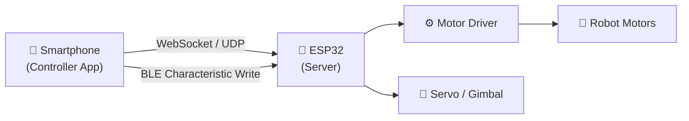
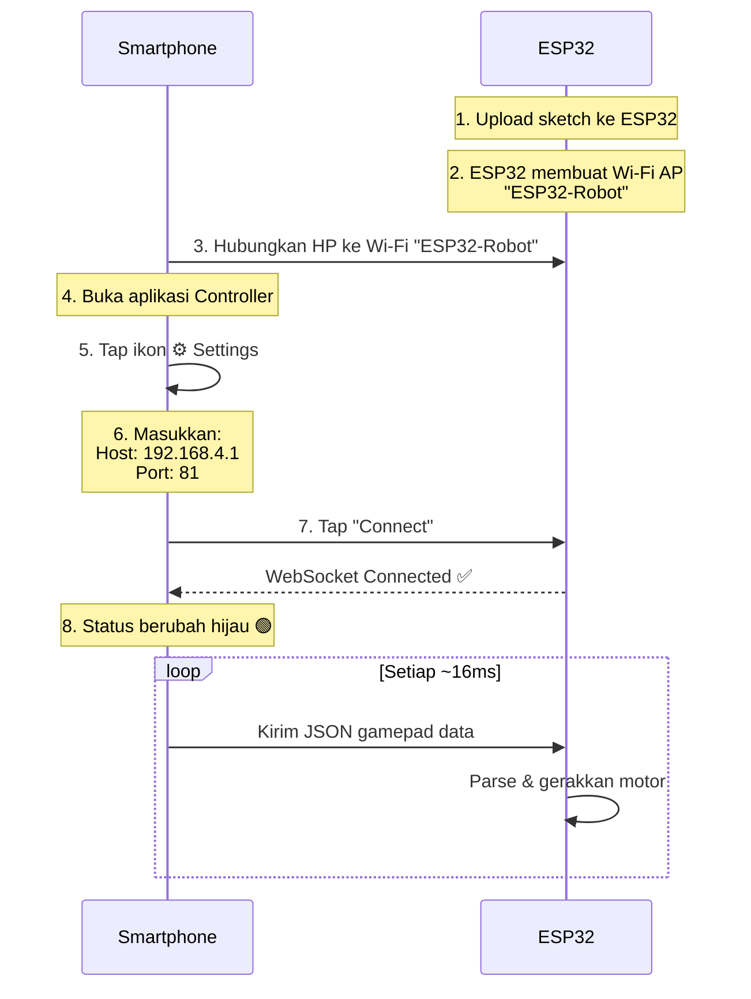

# 🤖 Panduan Koneksi & Setup ESP32 untuk GamePad Controller

Panduan lengkap untuk menghubungkan dan men-setting kode pada ESP32 agar bisa berkomunikasi dengan aplikasi **Controller React Native**.

---

## 📋 Daftar Isi

1. [Kebutuhan Hardware & Software](#1-kebutuhan-hardware--software)
2. [Arsitektur Komunikasi](#2-arsitektur-komunikasi)
3. [Setup ESP32 — Mode Wi-Fi (WebSocket)](#3-setup-esp32--mode-wi-fi-websocket)
4. [Setup ESP32 — Mode BLE (Bluetooth)](#4-setup-esp32--mode-ble-bluetooth)
5. [Format Data / Protokol](#5-format-data--protokol)
6. [Mapping Axis ke Motor](#6-mapping-axis-ke-motor)
7. [Safety: Watchdog Timer](#7-safety-watchdog-timer)
8. [Koneksi dari Aplikasi Mobile](#8-koneksi-dari-aplikasi-mobile)
9. [Troubleshooting](#9-troubleshooting)

---

## 1. Kebutuhan Hardware & Software

### Hardware
| Komponen | Keterangan |
|----------|------------|
| **ESP32 Dev Board** | ESP32-WROOM-32, ESP32-S3, atau varian lain |
| **Motor Driver** | L298N, TB6612FNG, atau driver motor lain |
| **Motor DC / Servo** | Sesuai kebutuhan robot |
| **Power Supply** | Baterai LiPo 7.4V atau sesuai motor |
| **Smartphone** | Android atau iOS dengan aplikasi Controller |

### Software
| Software | Versi |
|----------|-------|
| **Arduino IDE** | 2.x (atau PlatformIO) |
| **ESP32 Board Package** | Terbaru dari Espressif |
| **Library ArduinoJson** | v6.x atau v7.x |
| **Library arduinoWebSockets** | by Links2004 |

### Instalasi Library di Arduino IDE

1. Buka **Arduino IDE** → **Tools** → **Manage Libraries...**
2. Cari dan install:
   - `ArduinoJson` oleh Benoît Blanchon
   - `WebSockets` oleh Markus Sattler (Links2004)

---

## 2. Arsitektur Komunikasi



Aplikasi mendukung **dua mode koneksi**:

| Mode | Transport | Port Default | Kegunaan |
|------|-----------|-------------|----------|
| **Wi-Fi** | WebSocket | `81` | Utama — perintah & data analog |
| **Wi-Fi** | UDP | `8888` | Opsional — streaming analog latensi rendah |
| **BLE** | GATT Write | — | Alternatif tanpa Wi-Fi |

> [!IMPORTANT]
> Smartphone dan ESP32 **harus berada di jaringan Wi-Fi yang sama**, ATAU ESP32 berjalan sebagai **Access Point (AP)** sendiri.

---

## 3. Setup ESP32 — Mode Wi-Fi (WebSocket)

Ini adalah mode **utama dan paling disarankan**. Aplikasi mobile akan terkoneksi via WebSocket ke ESP32.

### 3.1. Sketch Lengkap (Mode AP — Tanpa Router)

Mode AP berarti ESP32 membuat jaringan Wi-Fi sendiri. Smartphone terhubung langsung ke jaringan ESP32.

> [!TIP]
> Mode AP adalah cara **paling mudah** untuk memulai. Tidak perlu router Wi-Fi. IP default ESP32 dalam mode AP: `192.168.4.1`

```cpp
#include <WiFi.h>
#include <WebSocketsServer.h>
#include <ArduinoJson.h>

// ============================================================
// KONFIGURASI — Sesuaikan bagian ini dengan hardware kamu
// ============================================================

// Wi-Fi Access Point
const char* AP_SSID     = "ESP32-Robot";    // Nama Wi-Fi yang dibuat ESP32
const char* AP_PASSWORD = "12345678";        // Password minimal 8 karakter

// WebSocket port — harus sama dengan port di aplikasi (default: 81)
const int WS_PORT = 81;

// Pin motor (sesuaikan dengan wiring hardware kamu)
const int LEFT_DIR_PIN  = 25;   // Pin arah motor kiri
const int LEFT_PWM_PIN  = 26;   // Pin PWM motor kiri
const int RIGHT_DIR_PIN = 27;   // Pin arah motor kanan
const int RIGHT_PWM_PIN = 14;   // Pin PWM motor kanan

// Pin servo (opsional — untuk gimbal kamera, dll.)
// #include <ESP32Servo.h>
// Servo panServo;
// Servo tiltServo;
// const int PAN_SERVO_PIN  = 12;
// const int TILT_SERVO_PIN = 13;

// Watchdog: hentikan motor jika tidak ada data masuk selama 500ms
const unsigned long WATCHDOG_TIMEOUT_MS = 500;

// ============================================================
// VARIABEL GLOBAL
// ============================================================

WebSocketsServer webSocket(WS_PORT);
unsigned long lastPacketMs = 0;

// Status koneksi
bool clientConnected = false;

// ============================================================
// FUNGSI MOTOR
// ============================================================

void setupMotors() {
  pinMode(LEFT_DIR_PIN,  OUTPUT);
  pinMode(LEFT_PWM_PIN,  OUTPUT);
  pinMode(RIGHT_DIR_PIN, OUTPUT);
  pinMode(RIGHT_PWM_PIN, OUTPUT);
}

void applyMotorControl(int lx, int ly) {
  // Differential drive (tank steering):
  //   LY = maju/mundur, LX = belok kiri/kanan
  int leftSpeed  = constrain(ly - lx, -100, 100);
  int rightSpeed = constrain(ly + lx, -100, 100);

  // Konversi -100…100 ke PWM 0…255
  int leftPwm  = map(abs(leftSpeed),  0, 100, 0, 255);
  int rightPwm = map(abs(rightSpeed), 0, 100, 0, 255);

  // Atur arah
  digitalWrite(LEFT_DIR_PIN,  leftSpeed  >= 0 ? HIGH : LOW);
  digitalWrite(RIGHT_DIR_PIN, rightSpeed >= 0 ? HIGH : LOW);

  // Atur kecepatan
  analogWrite(LEFT_PWM_PIN,  leftPwm);
  analogWrite(RIGHT_PWM_PIN, rightPwm);
}

void stopAllMotors() {
  analogWrite(LEFT_PWM_PIN,  0);
  analogWrite(RIGHT_PWM_PIN, 0);
}

// ============================================================
// HANDLER D-PAD (Opsional — gerak diskret)
// ============================================================

void applyDpad(const char* dpad) {
  if (strcmp(dpad, "UP") == 0) {
    applyMotorControl(0, 80);     // Maju
  } else if (strcmp(dpad, "DOWN") == 0) {
    applyMotorControl(0, -80);    // Mundur
  } else if (strcmp(dpad, "LEFT") == 0) {
    applyMotorControl(-60, 0);    // Belok kiri
  } else if (strcmp(dpad, "RIGHT") == 0) {
    applyMotorControl(60, 0);     // Belok kanan
  }
}

// ============================================================
// HANDLER TOMBOL (Opsional)
// ============================================================

void applyButtons(JsonArray btnArray) {
  for (const char* btn : btnArray) {
    if (strcmp(btn, "A") == 0) {
      // Aksi tombol A — misal: klakson, LED, dll.
      Serial.println("Tombol A ditekan");
    } else if (strcmp(btn, "B") == 0) {
      Serial.println("Tombol B ditekan");
    } else if (strcmp(btn, "X") == 0) {
      Serial.println("Tombol X ditekan");
    } else if (strcmp(btn, "Y") == 0) {
      Serial.println("Tombol Y ditekan");
    } else if (strcmp(btn, "LT") == 0) {
      Serial.println("Tombol LT ditekan");
    } else if (strcmp(btn, "RT") == 0) {
      Serial.println("Tombol RT ditekan");
    }
    // Tambahkan aksi lain sesuai kebutuhan
  }
}

// ============================================================
// WEBSOCKET EVENT HANDLER
// ============================================================

void webSocketEvent(uint8_t clientNum, WStype_t type,
                    uint8_t* payload, size_t length) {
  switch (type) {

    case WStype_CONNECTED:
      clientConnected = true;
      Serial.printf("[WS] Client #%u terhubung\n", clientNum);
      break;

    case WStype_DISCONNECTED:
      clientConnected = false;
      stopAllMotors();
      Serial.printf("[WS] Client #%u terputus\n", clientNum);
      break;

    case WStype_TEXT: {
      // Parse JSON payload dari aplikasi
      StaticJsonDocument<256> doc;
      DeserializationError err = deserializeJson(doc, payload);

      if (err) {
        Serial.printf("[WS] JSON error: %s\n", err.c_str());
        return;
      }

      // Update watchdog
      lastPacketMs = millis();

      // Baca data analog stick
      int lx = doc["LX"] | 0;
      int ly = doc["LY"] | 0;
      int rx = doc["RX"] | 0;
      int ry = doc["RY"] | 0;

      // Terapkan kontrol motor dari stick kiri
      applyMotorControl(lx, ly);

      // Terapkan servo/gimbal dari stick kanan (jika dipakai)
      // applyGimbal(rx, ry);

      // Proses D-Pad (jika ada, dan stick kiri dalam posisi center)
      if (doc.containsKey("DPAD") && !doc["DPAD"].isNull()) {
        const char* dpad = doc["DPAD"];
        if (lx == 0 && ly == 0) {
          applyDpad(dpad);
        }
      }

      // Proses tombol
      if (doc.containsKey("BTN")) {
        JsonArray btnArray = doc["BTN"];
        applyButtons(btnArray);
      }

      // Debug: cetak payload ke Serial Monitor
      Serial.printf("LX:%d LY:%d RX:%d RY:%d\n", lx, ly, rx, ry);
      break;
    }

    default:
      break;
  }
}

// ============================================================
// SETUP
// ============================================================

void setup() {
  Serial.begin(115200);
  Serial.println("\n=== ESP32 Robot GamePad Controller ===");

  // Setup pin motor
  setupMotors();

  // Buat Access Point Wi-Fi
  WiFi.softAP(AP_SSID, AP_PASSWORD);
  Serial.printf("Wi-Fi AP aktif: %s\n", AP_SSID);
  Serial.printf("Password: %s\n", AP_PASSWORD);
  Serial.print("ESP32 IP: ");
  Serial.println(WiFi.softAPIP());   // Biasanya 192.168.4.1

  // Mulai WebSocket server
  webSocket.begin();
  webSocket.onEvent(webSocketEvent);
  Serial.printf("WebSocket server berjalan di port %d\n", WS_PORT);
  Serial.println("Siap menerima koneksi dari aplikasi...\n");
}

// ============================================================
// LOOP
// ============================================================

void loop() {
  webSocket.loop();

  // Watchdog: hentikan motor jika tidak ada paket masuk
  if (clientConnected && (millis() - lastPacketMs > WATCHDOG_TIMEOUT_MS)) {
    stopAllMotors();
  }
}
```

### 3.2. Sketch Mode Station (Terhubung ke Router Wi-Fi)

Jika ingin ESP32 terhubung ke router Wi-Fi yang ada (bukan mode AP), ganti bagian `setup()`:

```cpp
void setup() {
  Serial.begin(115200);

  setupMotors();

  // Hubungkan ke jaringan Wi-Fi yang ada
  WiFi.begin("NamaWiFiRumah", "PasswordWiFi");
  Serial.print("Menghubungkan ke Wi-Fi");

  while (WiFi.status() != WL_CONNECTED) {
    delay(500);
    Serial.print(".");
  }

  Serial.println("\nTerhubung!");
  Serial.print("ESP32 IP: ");
  Serial.println(WiFi.localIP());   // ← Catat IP ini untuk dimasukkan di app

  webSocket.begin();
  webSocket.onEvent(webSocketEvent);
  Serial.printf("WebSocket port: %d\n", WS_PORT);
}
```

> [!WARNING]
> Dalam mode Station, IP ESP32 bisa berubah setiap restart. Disarankan atur **Static IP** di router atau gunakan kode berikut:
> ```cpp
> IPAddress local_IP(192, 168, 1, 100);
> IPAddress gateway(192, 168, 1, 1);
> IPAddress subnet(255, 255, 255, 0);
> WiFi.config(local_IP, gateway, subnet);
> WiFi.begin("NamaWiFi", "Password");
> ```

---

## 4. Setup ESP32 — Mode BLE (Bluetooth)

Mode BLE menggunakan GATT characteristic untuk menerima data dari aplikasi. Cocok jika tidak ada jaringan Wi-Fi.

> [!NOTE]
> Dukungan BLE di aplikasi masih dalam pengembangan. Untuk saat ini gunakan **mode Wi-Fi** sebagai koneksi utama.

### Sketch Dasar BLE

```cpp
#include <BLEDevice.h>
#include <BLEServer.h>
#include <BLEUtils.h>
#include <BLE2902.h>
#include <ArduinoJson.h>

// UUID — harus cocok dengan yang di aplikasi mobile
#define SERVICE_UUID        "4fafc201-1fb5-459e-8fcc-c5c9c331914b"
#define CHARACTERISTIC_UUID "beb5483e-36e1-4688-b7f5-ea07361b26a8"

bool deviceConnected = false;
unsigned long lastPacketMs = 0;

class ServerCallbacks : public BLEServerCallbacks {
  void onConnect(BLEServer* pServer) {
    deviceConnected = true;
    Serial.println("[BLE] Client terhubung");
  }
  void onDisconnect(BLEServer* pServer) {
    deviceConnected = false;
    stopAllMotors();
    Serial.println("[BLE] Client terputus");
    // Mulai advertising lagi
    pServer->getAdvertising()->start();
  }
};

class CharacteristicCallbacks : public BLECharacteristicCallbacks {
  void onWrite(BLECharacteristic* pCharacteristic) {
    String value = pCharacteristic->getValue();

    if (value.length() > 0) {
      StaticJsonDocument<256> doc;
      DeserializationError err = deserializeJson(doc, value);

      if (!err) {
        lastPacketMs = millis();

        int lx = doc["LX"] | 0;
        int ly = doc["LY"] | 0;
        applyMotorControl(lx, ly);

        Serial.printf("BLE → LX:%d LY:%d\n", lx, ly);
      }
    }
  }
};

void setupBLE() {
  BLEDevice::init("ESP32-Robot");
  BLEServer* pServer = BLEDevice::createServer();
  pServer->setCallbacks(new ServerCallbacks());

  BLEService* pService = pServer->createService(SERVICE_UUID);

  BLECharacteristic* pCharacteristic = pService->createCharacteristic(
    CHARACTERISTIC_UUID,
    BLECharacteristic::PROPERTY_WRITE |
    BLECharacteristic::PROPERTY_WRITE_NR
  );

  pCharacteristic->setCallbacks(new CharacteristicCallbacks());
  pService->start();

  BLEAdvertising* pAdvertising = BLEDevice::getAdvertising();
  pAdvertising->addServiceUUID(SERVICE_UUID);
  pAdvertising->start();

  Serial.println("[BLE] Advertising dimulai...");
}
```

### Format Binary (Opsional — Lebih Efisien untuk BLE)

Karena BLE 4.x hanya mendukung max 20 bytes per paket, gunakan format binary 7 bytes:

```
Byte 0: flags (reserved)
Byte 1: LX + 100  (0–200, di-decode jadi -100 s/d 100)
Byte 2: LY + 100
Byte 3: RX + 100
Byte 4: RY + 100
Byte 5: DPAD (0=none, 1=UP, 2=DOWN, 3=LEFT, 4=RIGHT)
Byte 6-7: BTN bitmask (lihat tabel di bawah)
```

| Bit | Tombol |
|-----|--------|
| 0 | A |
| 1 | B |
| 2 | X |
| 3 | Y |
| 4 | LT |
| 5 | RT |
| 6 | LB |
| 7 | RB |
| 8 | LS |
| 9 | RS |

---

## 5. Format Data / Protokol

Aplikasi mengirimkan data dalam format **JSON** melalui WebSocket:

```json
{
  "LX": 45,
  "LY": -80,
  "RX": 0,
  "RY": 0,
  "BTN": ["A", "LB"],
  "DPAD": "UP"
}
```

### Penjelasan Field

| Field | Tipe | Range | Keterangan |
|-------|------|-------|------------|
| `LX` | integer | −100 … 100 | Stick kiri horizontal. Positif = kanan |
| `LY` | integer | −100 … 100 | Stick kiri vertikal. Positif = bawah (layar) |
| `RX` | integer | −100 … 100 | Stick kanan horizontal |
| `RY` | integer | −100 … 100 | Stick kanan vertikal |
| `BTN` | string[] | — | Tombol aktif: `"A"`, `"B"`, `"X"`, `"Y"`, `"LT"`, `"RT"`, `"LB"`, `"RB"`, `"LS"`, `"RS"` |
| `DPAD` | string \| null | — | `"UP"`, `"DOWN"`, `"LEFT"`, `"RIGHT"`, atau `null` |

> [!TIP]
> Data dikirim dengan rate **max ~60 fps** (1 paket per 16ms). ESP32 akan menerima data secara terus-menerus selama terhubung.

---

## 6. Mapping Axis ke Motor

### Differential Drive (Tank Steering) — Stick Kiri

```
         LY = -100 (maju)
              ▲
              │
 LX = -100 ◄─┼─► LX = +100
  (kiri)      │     (kanan)
              ▼
         LY = +100 (mundur)
```

```cpp
void applyMotorControl(int lx, int ly) {
  int leftSpeed  = constrain(ly - lx, -100, 100);
  int rightSpeed = constrain(ly + lx, -100, 100);

  int leftPwm  = map(abs(leftSpeed),  0, 100, 0, 255);
  int rightPwm = map(abs(rightSpeed), 0, 100, 0, 255);

  digitalWrite(LEFT_DIR_PIN,  leftSpeed  >= 0 ? HIGH : LOW);
  digitalWrite(RIGHT_DIR_PIN, rightSpeed >= 0 ? HIGH : LOW);
  analogWrite(LEFT_PWM_PIN,  leftPwm);
  analogWrite(RIGHT_PWM_PIN, rightPwm);
}
```

### Servo / Gimbal — Stick Kanan (Opsional)

```cpp
void applyGimbal(int rx, int ry) {
  int panAngle  = map(rx, -100, 100, 0, 180);   // Horizontal
  int tiltAngle = map(ry, -100, 100, 0, 180);   // Vertikal
  panServo.write(panAngle);
  tiltServo.write(tiltAngle);
}
```

---

## 7. Safety: Watchdog Timer

> [!CAUTION]
> **WAJIB diimplementasikan!** Tanpa watchdog, robot bisa terus bergerak jika koneksi terputus tiba-tiba (misalnya HP kehabisan baterai atau keluar dari jangkauan).

```cpp
const unsigned long WATCHDOG_TIMEOUT_MS = 500;  // 500ms tanpa paket → stop
unsigned long lastPacketMs = 0;

void loop() {
  webSocket.loop();

  // Jika sudah >500ms tidak ada data masuk → hentikan motor
  if (millis() - lastPacketMs > WATCHDOG_TIMEOUT_MS) {
    stopAllMotors();
  }
}
```

Mekanisme:
1. Setiap paket masuk → update `lastPacketMs = millis()`
2. Di `loop()`, cek selisih waktu
3. Jika lebih dari 500ms → `stopAllMotors()`
4. Motor akan aktif lagi saat paket baru masuk

---

## 8. Koneksi dari Aplikasi Mobile

### Langkah-Langkah Koneksi



### Pengaturan di Aplikasi

1. **Buka aplikasi** Controller React Native
2. **Tap tombol Settings** (⚙️) di area tengah gamepad
3. **Masukkan pengaturan koneksi**:

| Setting | Nilai (Mode AP) | Nilai (Mode Station) |
|---------|-----------------|---------------------|
| **Host** | `192.168.4.1` | IP dari Serial Monitor (misal `192.168.1.100`) |
| **Port** | `81` | `81` (atau port kustom) |

4. **Tap "Connect"**
5. Tunggu status berubah **🟢 Connected**
6. Mulai kontrol robot! 🎮

### Status Koneksi di Aplikasi

| Status | Indikator | Keterangan |
|--------|-----------|------------|
| 🔴 `disconnected` | Abu-abu | Belum terhubung |
| 🟡 `connecting` | Kuning berkedip | Sedang menyambung |
| 🟢 `connected` | Hijau solid | Terhubung & aktif |
| 🟡 `reconnecting` | Kuning berkedip | Mencoba sambung ulang (max 3x) |
| 🔴 `error` | Merah | Gagal terhubung |

---

## 9. Troubleshooting

### Masalah Umum & Solusi

| Masalah | Kemungkinan Penyebab | Solusi |
|---------|---------------------|--------|
| Aplikasi tidak bisa connect | HP belum terhubung ke Wi-Fi ESP32 | Pastikan HP terhubung ke `ESP32-Robot` di Settings Wi-Fi HP |
| Status selalu "connecting" | IP atau port salah | Periksa Serial Monitor ESP32 untuk IP, pastikan port = `81` |
| Motor tidak bergerak | Wiring salah atau pin tidak cocok | Periksa koneksi kabel motor dan sesuaikan pin di sketch |
| Koneksi sering putus | Jarak terlalu jauh / interferensi | Dekatkan HP ke ESP32, atau gunakan antena eksternal |
| Robot tidak berhenti saat HP disconnect | Watchdog tidak diimplementasi | Pastikan kode watchdog ada di `loop()` |
| Data terkirim tapi motor lambat respon | Parsing JSON error | Cek Serial Monitor untuk error message; pastikan baud rate `115200` |
| Tidak bisa upload sketch | Port COM tidak terdeteksi | Install driver CP2102/CH340; pilih board & port yang benar di Arduino IDE |

### Tips Debugging

```cpp
// Tambahkan di webSocketEvent (case WStype_TEXT) untuk debug:
Serial.printf("RAW payload: %s\n", (char*)payload);
serializeJsonPretty(doc, Serial);
Serial.println();
```

> [!TIP]
> Buka **Serial Monitor** di Arduino IDE (baud rate `115200`) saat development. Semua log koneksi dan data masuk akan tampil di sana.

---

## 📌 Quick Start Checklist

- [ ] Install Arduino IDE + ESP32 Board Package
- [ ] Install library `ArduinoJson` dan `WebSockets`
- [ ] Salin sketch Wi-Fi (Mode AP) ke Arduino IDE
- [ ] Sesuaikan pin motor di bagian `KONFIGURASI`
- [ ] Upload sketch ke ESP32
- [ ] Buka Serial Monitor → catat IP address
- [ ] Hubungkan HP ke Wi-Fi `ESP32-Robot` (password: `12345678`)
- [ ] Buka aplikasi Controller → Settings → masukkan IP & Port
- [ ] Tap Connect → status hijau 🟢
- [ ] Gerakkan analog stick → robot bergerak! 🎮🤖

---

> [!NOTE]
> **Default Settings di Aplikasi:**
> - Host: `192.168.4.1` (sudah cocok untuk mode AP)
> - Port: `81`
>
> Jadi jika menggunakan mode AP dengan setting default, cukup hubungkan ke Wi-Fi ESP32 lalu langsung tap Connect!
